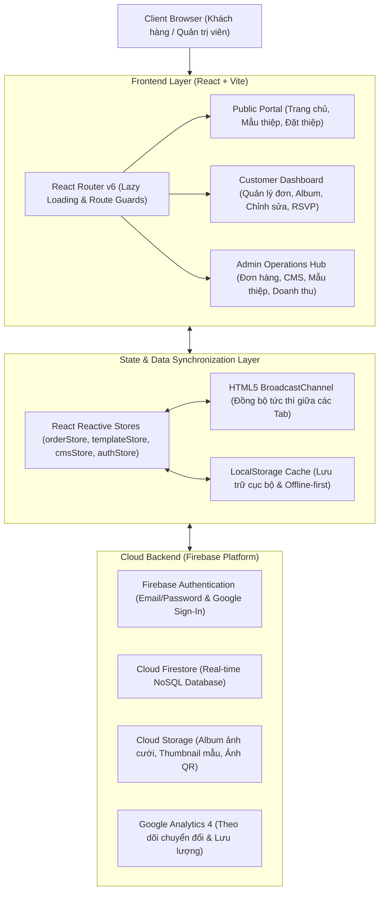
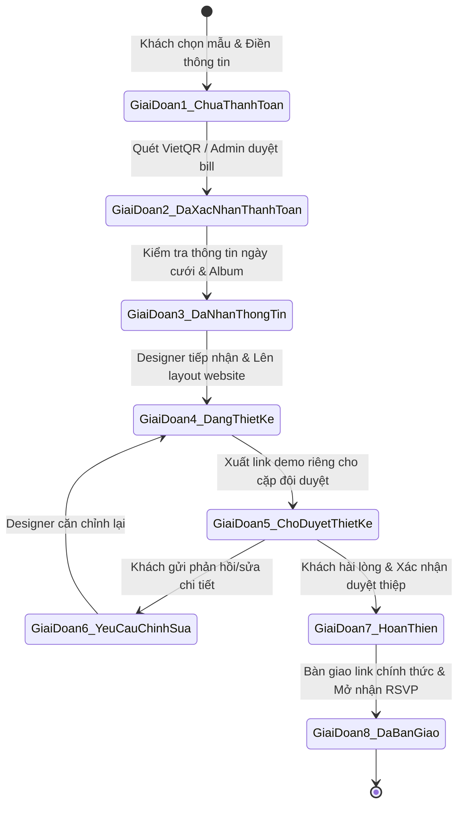
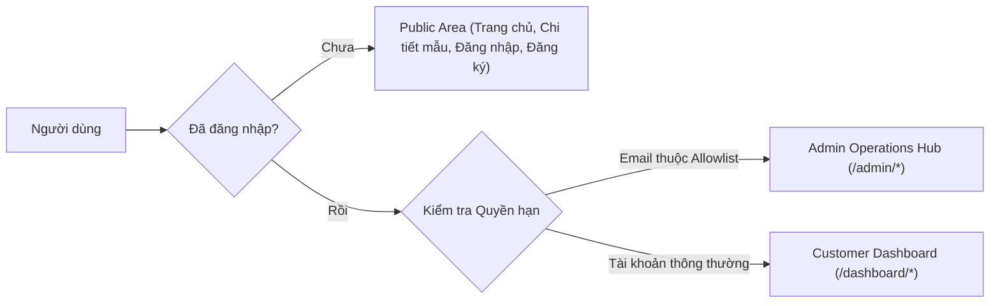

# Kiến Trúc Hệ Thống & Cấu Trúc Dự Án: Nhà Có Tiệc (Architecture.md)

> **Dự án:** Nền tảng phát hành và quản lý website thiệp cưới trực tuyến cao cấp Nhà Có Tiệc  
> **Phiên bản:** 1.0.0 Production Ready  
> **Cập nhật lần cuối:** 27/09/2026  
> **Công nghệ chủ đạo:** React 18, TypeScript 5, Vite 6, Tailwind CSS 3, Firebase 12 (Auth, Firestore, Storage, Analytics).

---

## 1. Tổng Quan Kiến Trúc (Architecture Overview)

Hệ thống **Nhà Có Tiệc** được thiết kế theo mô hình **Single Page Application (SPA)** hiện đại, hướng kiến trúc **Hybrid Realtime (Firestore + LocalStorage + HTML5 BroadcastChannel)** nhằm mang lại trải nghiệm 0ms độ trễ cho người dùng nhưng vẫn đảm bảo tính đồng bộ dữ liệu thời gian thực trên mọi thiết bị.



---

## 2. Cấu Trúc Thư Mục Chi Tiết (Project Directory Structure)

```text
nha-co-tiec/
├── public/                       # Tài nguyên tĩnh phát hành trực tiếp
│   ├── hero-mobile.jpg           # Ảnh bìa Hero tối ưu cho thiết bị di động
│   ├── logo.png                  # Logo chính thức của Nhà Có Tiệc
│   └── vite.svg
├── src/
│   ├── app/                      # Điểm khởi tạo & Định tuyến ứng dụng
│   │   ├── App.tsx               # Root component gắn RouterProvider
│   │   ├── main.tsx              # Entry-point render React DOM
│   │   └── routes.tsx            # Bảng định tuyến URL, Lazy Loading & Phân quyền
│   ├── components/               # Các UI components tái sử dụng
│   │   ├── auth/                 # Bảo vệ phân quyền truy cập
│   │   │   └── ProtectedRoute.tsx# AdminRoute (Email Allowlist) & CustomerRoute
│   │   ├── common/               # Component hạt nhân
│   │   │   ├── Badge.tsx         # Huy hiệu gói (Cơ bản / Cao cấp / Trạng thái)
│   │   │   ├── Button.tsx        # Nút bấm chuẩn thiết kế
│   │   │   ├── Icon.tsx          # Google Material Symbols Outlined
│   │   │   ├── Modal.tsx         # Khung pop-up chuẩn
│   │   │   ├── RouteErrorBoundary.tsx # Bắt lỗi sự cố điều hướng trang
│   │   │   ├── SocialIcon.tsx    # Icon mạng xã hội (Facebook, TikTok, Zalo)
│   │   │   └── StatusChip.tsx    # Chip hiển thị 8 giai đoạn đơn hàng
│   │   └── layouts/              # Khung giao diện chính
│   │       ├── AdminLayout.tsx   # Dashboard quản trị, Menu bên, Giả lập điện thoại
│   │       ├── CustomerLayout.tsx# Khung giao diện khách hàng, Hotline động
│   │       └── PublicLayout.tsx  # Thanh điều hướng (Header Burgundy) & Chân trang
│   ├── features/                 # Các mô-đun chức năng nghiệp vụ (Domain Features)
│   │   ├── admin/                # Phân hệ Quản trị viên
│   │   │   ├── components/
│   │   │   │   └── TemplateFormModal.tsx # Thêm/Sửa mẫu thiệp cưới
│   │   │   └── pages/
│   │   │       ├── AdminAnalyticsPage.tsx     # Báo cáo doanh thu & Phân tích
│   │   │       ├── AdminCmsPage.tsx           # CMS Quản lý nội dung trang chủ & Liên hệ
│   │   │       ├── AdminGuestsPage.tsx        # Danh sách khách tham dự
│   │   │       ├── AdminGuestsWishesPage.tsx  # Quản lý khách mời & Kiểm duyệt lời chúc
│   │   │       ├── AdminInvitationsPage.tsx   # Quản lý liên kết thiệp đã phát hành
│   │   │       ├── AdminNotificationsPage.tsx # Trung tâm thông báo hệ thống
│   │   │       ├── AdminOrderDetailPage.tsx   # Chi tiết đơn, Duyệt tiền, Tiến độ thiết kế
│   │   │       ├── AdminOrdersPage.tsx        # Danh sách & Bộ lọc đơn hàng
│   │   │       ├── AdminOverviewPage.tsx      # Tổng quan vận hành & Biểu đồ điều hành
│   │   │       ├── AdminPaymentSettingsPage.tsx # Cài đặt tài khoản ngân hàng & Mã QR
│   │   │       ├── AdminSettingsPage.tsx      # Cài đặt thương hiệu & Email nhận tin
│   │   │       ├── AdminTemplatesPage.tsx     # Kho mẫu thiệp & Bật/Tắt ghim
│   │   │       ├── AdminUsersPage.tsx         # Quản lý tài khoản khách hàng
│   │   │       └── AdminWishesPage.tsx        # Lời chúc từ khách dự tiệc
│   │   ├── customer/             # Phân hệ Khách hàng (Cặp đôi)
│   │   │   ├── components/
│   │   │   │   ├── PhotoAlbumModal.tsx        # Upload & Xem trước album ảnh cưới
│   │   │   │   ├── RevisionModal.tsx          # Gửi yêu cầu chỉnh sửa thiệp
│   │   │   │   └── WeddingInfoModal.tsx       # Bổ sung thông tin lễ cưới
│   │   │   └── pages/
│   │   │       ├── CustomerAccountPage.tsx    # Cập nhật thông tin cá nhân & Đổi mật khẩu
│   │   │       ├── CustomerDashboardPage.tsx  # Cổng thông tin đơn hàng, Onboarding, RSVP
│   │   │       └── CustomerOrderDetailPage.tsx# Chi tiết tiến độ hoàn thiện thiệp cưới
│   │   └── public/               # Phân hệ Khách vãng lai & Đặt hàng
│   │       ├── components/
│   │       │   └── OrderFormModal.tsx         # Modal điền thông tin đặt hàng nhanh
│   │       └── pages/
│   │           ├── CheckoutQrPage.tsx         # Trang quét mã VietQR tự động & Upload bill
│   │           ├── ContactPage.tsx            # Trang liên hệ & Bản đồ
│   │           ├── HomePage.tsx               # Trang chủ Showcase (Hero, Mẫu ghim, Đánh giá)
│   │           ├── LoginPage.tsx              # Đăng nhập Email/Password & Google
│   │           ├── OrderWeddingInfoPage.tsx   # Form 5 bước thu thập thông tin lễ cưới
│   │           ├── RegisterPage.tsx           # Đăng ký tài khoản khách hàng
│   │           ├── TemplateDetailPage.tsx     # Chi tiết mẫu, Giả lập smartphone sang trọng
│   │           └── TemplatesPage.tsx          # Bộ sưu tập tất cả mẫu thiệp cưới
│   ├── mocks/                    # State Stores & Bộ nhớ đệm dữ liệu (Persistent Stores)
│   │   ├── authStore.ts          # State xác thực, Quản lý phiên, Admin Allowlist
│   │   ├── cmsStore.ts           # State CMS nội dung website, Hotline, Banner
│   │   ├── mockOrders.ts         # Dữ liệu hạt giống đơn hàng ban đầu
│   │   ├── mockTemplates.ts      # Dữ liệu hạt giống các mẫu thiệp mặc định
│   │   ├── notificationStore.ts  # Thông báo đơn hàng mới, thanh toán, duyệt thiết kế
│   │   ├── orderStore.ts         # Xử lý quy trình đơn hàng 8 giai đoạn & RSVP
│   │   ├── paymentSettingsStore.ts# Cấu hình thanh toán VietQR & Tài khoản thụ hưởng
│   │   └── templateStore.ts      # Quản lý danh mục mẫu thiệp, Ghim trang chủ
│   ├── services/                 # Tầng giao tiếp dịch vụ bên ngoài (External Services)
│   │   ├── activityLogService.ts # Ghi nhật ký thao tác người dùng & Quản trị
│   │   ├── firebase.ts           # Cấu hình & Khởi tạo SDK Firebase (Auth, DB, Storage)
│   │   └── storageService.ts     # Xử lý tải ảnh lên Storage kèm Fallback nén Canvas
│   ├── types/                    # Định nghĩa kiểu dữ liệu TypeScript (Type Contracts)
│   │   ├── auth.ts               # User, Role (admin/customer), Session
│   │   ├── cms.ts                # Cấu trúc nội dung Hero, Footer, Đánh giá, Hotline
│   │   ├── notification.ts       # Thông báo hệ thống
│   │   ├── order.ts              # Đơn hàng, 8 Trạng thái, Thông tin cưới, Khách mời
│   │   ├── payment.ts            # Cài đặt VietQR, Lịch sử giao dịch
│   │   └── template.ts           # Mẫu thiệp, Tính năng, Tỷ lệ ảnh, Nhạc nền
│   ├── utils/                    # Các hàm tiện ích dùng chung
│   │   ├── constants.ts          # Hằng số hệ thống, Danh sách ngân hàng, Enum
│   │   ├── formatters.ts         # Định dạng tiền tệ VND, Ngày tháng ISO, Giờ tiệc
│   │   └── searchHelper.ts       # Tìm kiếm tiếng Việt không dấu & Lọc nâng cao
│   └── index.css                 # CSS toàn cục, Tailwind directives, Phông chữ
├── stitch_export/                # Thư viện thiết kế nguồn gốc từ Stitch Design
├── index.html                    # HTML Template gốc gắn Font Lora, Playfair, Be Vietnam
├── package.json                  # Khai báo thư viện phụ thuộc & Script Build
├── tailwind.config.js            # Hệ thống màu sắc thương hiệu (Burgundy, Gold, Cream)
├── tsconfig.json                 # Cấu hình kiểm tra kiểu TypeScript chặt chẽ
└── vite.config.ts                # Cấu hình Bundle, Code Splitting & Tối ưu hóa Build
```

---

## 3. Hệ Thống Dữ Liệu & Quy Trình 8 Giai Đoạn Đơn Hàng (Order State Machine)

Một đơn hàng thiệp cưới tại Nhà Có Tiệc trải qua chu trình 8 bước nghiêm ngặt được đồng bộ thời gian thực:



### Chi tiết ánh xạ mã trạng thái (Order Status Mapping)
| Giai đoạn | Tên hiển thị | Mã Trạng Thái (`orderStatus`) | Mô tả chi tiết |
|---|---|---|---|
| **Giai đoạn 1** | Chờ thanh toán | `pending_payment` | Khách đã chọn mẫu, tạo đơn nhưng chưa hoàn tất chuyển khoản VietQR |
| **Giai đoạn 2** | Đã thanh toán | `payment_confirmed` | Admin xác nhận đã nhận tiền hoặc hệ thống đối soát QR thành công |
| **Giai đoạn 3** | Đã nhận thông tin | `info_received` | Đầy đủ thông tin gia đình 2 họ, ngày giờ, địa điểm & album ảnh |
| **Giai đoạn 4** | Đang thiết kế | `designing` | Ekip thiết kế Nhà Có Tiệc đang dựng website thiệp cưới độc bản |
| **Giai đoạn 5** | Chờ duyệt mẫu | `review_ready` | Bản dựng thiệp hoàn thành, gửi khách hàng kiểm tra nội dung |
| **Giai đoạn 6** | Yêu cầu chỉnh sửa | `revision_requested` | Khách gửi danh sách nội dung cần sửa đổi (được miễn phí 1 lần) |
| **Giai đoạn 7** | Thiết kế hoàn tất | `completed` | Thiệp đã chốt thiết kế, gắn tên miền riêng và sẵn sàng chia sẻ |
| **Giai đoạn 8** | Đã bàn giao | `delivered` | Khách nhận trọn bộ link thiệp, danh sách khách mời RSVP và sổ lưu bút |

---

## 4. Cơ Chế Đồng Bộ Dữ Liệu Thời Gian Thực (Dual-Layer Sync)

Để loại bỏ hoàn toàn độ trễ mạng và hiện tượng dữ liệu không đồng nhất giữa các tab, ứng dụng vận hành cơ chế **3 tầng đồng bộ**:

1. **Tầng 1: Tức thì (0ms - In-Memory & BroadcastChannel)**  
   - Khi có bất kỳ hành động nào (tạo đơn, cập nhật trạng thái, upload ảnh), Store ngay lập tức cập nhật biến bộ nhớ trong và phát tín hiệu qua `BroadcastChannel`.
   - Tất cả các tab khác cùng mở trên trình duyệt lập tức re-render trong vòng chưa đầy 5ms mà không cần đợi API mạng.
2. **Tầng 2: Bền vững cục bộ (LocalStorage Fallback)**  
   - Dữ liệu luôn được lưu vào LocalStorage (`nha_co_tiec_orders_v7_realtime`, `nha_co_tiec_cms_v8`, v.v.).
   - Nếu người dùng mất mạng Internet hoặc mở lại trình duyệt sau nhiều ngày, giao diện vẫn hiển thị dữ liệu ngay lập tức (Offline-first).
3. **Tầng 3: Đồng bộ đám mây toàn cầu (Firebase Firestore Listener)**  
   - Phương thức `onSnapshot` kết nối trực tiếp với các collection `orders`, `templates`, `cms_content`, `payment_settings`.
   - Đảm bảo khi Admin duyệt đơn trên máy tính văn phòng, điện thoại của khách hàng ở nhà lập tức đổi trạng thái sang "Đã thanh toán".

---

## 5. Hệ Thống Định Danh & Phân Quyền (Security & Auth Model)

Hệ thống bảo vệ phân quyền ở cả tầng Client (React Router) và tầng Lưu trữ (Firebase Rules):



### Danh sách Email Quản trị viên Mặc định (Admin Allowlist):
- `kieumllnn@gmail.com`
- `vutrang280805@gmail.com`
- `haiyenng4598@gmail.com`
- `tranthihuyentrang07122005@gmail.com`
- `admin@nhacotiec.vn`
- Hỗ trợ biến môi trường mở rộng: `VITE_ADMIN_EMAILS` trên Vercel.

---

## 6. Thiết Kế Giao Diện & Bộ Nhận Diện Thương Hiệu (Design Tokens)

Dự án áp dụng ngôn ngữ thiết kế **Editorial Luxury Wedding**, kết hợp nét cổ điển trang nhã và giao diện hiện đại:

- **Màu sắc chủ đạo:**
  - `burgundy-wine` (`#6D141A`): Màu đỏ vang quý phái, dùng cho Header, nút CTA chính, điểm nhấn cảm xúc.
  - `gold-foil` (`#C4A47C`): Màu vàng kim ánh kim loại, dùng cho viền điện thoại, biểu tượng ngôi sao, huy hiệu cao cấp.
  - `surface-cream` (`#F9F5EF`): Màu nền kem trang nhã tạo cảm giác như giấy mỹ thuật cao cấp.
  - `deep-espresso` (`#2C2623`): Màu nâu đen ấm áp, thay thế màu đen thuần giúp chữ viết mềm mại và dễ đọc.
- **Kiểu chữ (Typography):**
  - **Playfair Display**: Tiêu đề thương hiệu "Nhà Có Tiệc", các con số định giá và tiêu đề sang trọng.
  - **Lora**: Phông chữ có chân văn chương dành cho thông điệp tình yêu, trích dẫn lễ cưới.
  - **Be Vietnam Pro**: Phông chữ không chân hiện đại, tối ưu hiển thị tiếng Việt dấu câu rõ nét cho biểu mẫu và nội dung quản trị.
- **Mô phỏng điện thoại (Realistic Smartphone Mockup):**
  - Khung máy bo tròn `rounded-[38px]`, viền vàng kim `border-gold-foil/40`.
  - Cụm Dynamic Island tai thỏ trên cùng tạo cảm giác smartphone chân thực.
  - Thanh thương hiệu "Nhà Có Tiệc" phía trên đầu ảnh và thanh Home bar phía dưới.
  - Ảnh thiệp cưới trải rộng 100% bề ngang (`w-full`) tỷ lệ 9:16 chuẩn hóa thị giác.
